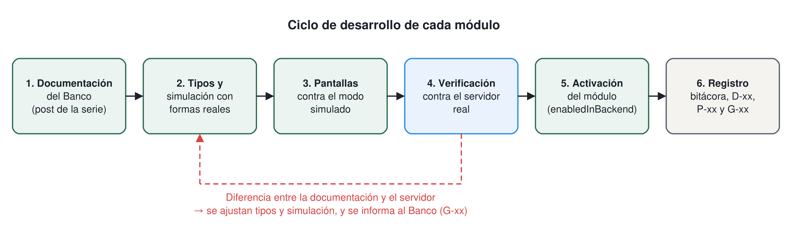

# Capítulo 1. Introducción y contexto

## 1.1 El Banco de Alimentos y su red de organizaciones sociales

Un banco de alimentos es una organización sin fines de lucro que recupera alimentos aptos para el
consumo (excedentes de producción, productos próximos a vencer o sin valor comercial) y los
redistribuye, sin costo, entre organizaciones sociales que asisten a personas en situación de
vulnerabilidad alimentaria.
<!-- REVISAR: agregar una fuente sobre la red de bancos de alimentos en Argentina y su alcance. -->

El presente trabajo se desarrolló junto con el Banco de Alimentos y su red de organizaciones
sociales. Estas organizaciones son comedores comunitarios, merenderos y entidades similares. Cada una
asiste a un conjunto de familias y recibe mercadería del Banco dentro de un cupo mensual, expresado en
kilogramos. Cada organización tiene, además, un referente o coordinador, que es la persona que
gestiona el vínculo con el Banco: registra a las familias asistidas, solicita mercadería, coordina
retiros y mantiene actualizados los datos y la documentación de la organización.

El Banco cuenta con un sistema de gestión propio, la plataforma Mermab. Su backend expone una API
REST multiinquilino (*multi-tenant*), compartida por varios bancos de alimentos, sobre la cual operan
el personal del Banco y sus distintos portales. La API incluye un conjunto de servicios destinados
específicamente al rol de organización social.

## 1.2 Planteamiento del problema

Gran parte de la interacción entre las organizaciones sociales y el Banco se resuelve por canales
informales y con intervención manual del personal del Banco: mensajes, llamadas, planillas y
documentación en papel. Esto trae varias dificultades:

- **Carga operativa del Banco.** Cada pedido, alta de familia, cambio de datos o consulta exige que el
  personal del Banco lo procese a mano.
- **Falta de visibilidad para la organización.** El referente no tiene un medio simple para saber el
  estado de un pedido, cuánto le queda del cupo del mes, qué recibió en un período o en qué medida lo
  recibido cubre las necesidades de las familias que asiste.
- **Información dispersa y desactualizada.** El padrón de familias, los contactos autorizados a retirar
  alimentos, la capacidad logística y los documentos de la organización se mantienen en registros
  aislados y difíciles de conciliar.
- **Heterogeneidad de los usuarios.** Los referentes tienen niveles muy distintos de alfabetización
  digital, y muchos sólo cuentan con un teléfono celular de gama baja y una conexión a Internet
  intermitente.

El problema que aborda este trabajo es, por lo tanto, la **ausencia de una herramienta digital
accesible**, pensada para el referente de la organización, que le permita gestionar de forma autónoma
su relación con el Banco y que se integre con el sistema que el Banco ya utiliza.

## 1.3 Antecedentes y redefinición del proyecto

La propuesta original de tesis se orientaba a la logística de distribución de alimentos entre las
sucursales de una cadena de supermercados y las organizaciones sociales. En la reunión del 8 de
septiembre de 2026 con el referente institucional del Banco se informó que esa vertical ya estaba
siendo implementada por el propio Banco desde el 1 de septiembre, por una decisión estratégica de la
empresa involucrada y con plazos incompatibles con los de una tesis.

En esa misma reunión se acordó redefinir el proyecto hacia la relación entre el Banco y las
**organizaciones sociales**, un ámbito sin la misma urgencia operativa y con mayor libertad de diseño.
La propuesta resultante planteó un portal digital para las organizaciones de la red, con
funcionalidades de gestión de pedidos, registro de familias, información nutricional, capacitación,
seguimiento de lo recibido y publicación de necesidades. También se acordó una división de
responsabilidades: el Banco desarrolla y mantiene el backend, y el equipo de tesis desarrolla el
frontend completo del portal.

<!-- PENDIENTE: incorporar aquí la segunda interfaz de la propuesta (chatbot de WhatsApp con agentes
de IA) cuando se documente esa parte del proyecto. -->

## 1.4 Justificación

El desarrollo del portal se justifica por las siguientes razones:

- **Impacto social.** Al reducir el tiempo que el referente y el personal del Banco dedican a tareas
  administrativas, se libera capacidad para la tarea sustantiva: la asistencia alimentaria.
- **Autonomía y transparencia.** La organización puede consultar por sí misma su cupo, el estado de sus
  pedidos, lo recibido y la cobertura nutricional. Así disminuyen las consultas repetitivas y mejora la
  confianza en el proceso.
- **Calidad de la información.** La carga directa por parte de la organización, con las validaciones del
  Banco aplicadas en el momento, mejora la completitud y la consistencia de los datos que el Banco usa
  para planificar.
- **Viabilidad técnica.** El Banco ya cuenta con un backend en producción, con servicios para el rol de
  organización. El aporte de este trabajo puede concentrarse en una aplicación cliente robusta que
  aproveche esos servicios, sin duplicar la lógica de negocio.
- **Pertinencia académica.** El proyecto integra problemas propios de la Ingeniería Informática en un
  contexto real: el desarrollo multiplataforma, la integración con una API externa en producción que
  no es controlada por el equipo, el diseño para condiciones de conectividad limitada y la
  accesibilidad.

## 1.5 Objetivos

### 1.5.1 Objetivo general

Diseñar e implementar una aplicación multiplataforma (Android, iOS y web) que permita a los referentes
de las organizaciones sociales gestionar su relación con el Banco de Alimentos de manera autónoma,
accesible y segura, integrada con la API de la plataforma Mermab.

### 1.5.2 Objetivos específicos

1. Relevar y analizar los servicios que la API del Banco ofrece al rol de organización, identificar
   sus reglas de negocio y documentar las brechas y los comportamientos no documentados.
2. Definir una arquitectura de cliente en capas que desacople la interfaz de usuario del acceso a
   datos y permita incorporar módulos a medida que el Banco los habilita.
3. Implementar la autenticación y la gestión de la sesión del referente, con almacenamiento seguro de
   credenciales.
4. Implementar la gestión del padrón de familias asistidas y de sus miembros: alta, edición, baja y
   resumen demográfico.
5. Implementar el circuito de pedidos de mercadería: consulta del catálogo y del cupo mensual,
   armado y confirmación del pedido, seguimiento de su estado, cancelación y descarga del remito.
6. Brindar a la organización información sobre lo recibido del Banco y sobre la cobertura nutricional
   de sus familias por grupo de alimentos.
7. Implementar un canal formal de comunicación con el Banco para registrar sucesos, solicitudes,
   consultas y reclamos, y hacer su seguimiento.
8. Implementar la gestión de los contactos de la organización y del perfil institucional: datos,
   dirección, capacidad logística y documentación.
9. Garantizar requerimientos no funcionales de accesibilidad, rendimiento en dispositivos de gama baja,
   tolerancia a la pérdida de conexión y seguridad en la comunicación con la API.
10. Documentar de forma sistemática el proceso de desarrollo, las decisiones de diseño y los problemas
    encontrados.

## 1.6 Alcance y límites

**Comprende:**

- Una aplicación cliente, construida sobre una única base de código, que se ejecuta como aplicación
  nativa en Android e iOS y como aplicación web progresiva (PWA) en el navegador.
- Los módulos de sesión y perfil del usuario; inicio; perfil, logística y documentación de la
  organización; familias y miembros; contactos; pedidos de mercadería; lo recibido y cobertura
  nutricional; comunicación con el Banco; avisos; y un recetario local con escalado de porciones.
- Un modo de datos simulados que reproduce las respuestas reales de la API. Permite el desarrollo y la
  demostración sin afectar el entorno de producción del Banco.
- Herramientas de soporte al desarrollo: generación de tipos a partir de la especificación OpenAPI,
  pruebas de humo contra la API real y registro automatizado de la bitácora.

**No comprende:**

- El desarrollo o la modificación del backend, que es responsabilidad del Banco. El trabajo se limita a
  consumir la API existente y a documentar sus faltantes y defectos para que el Banco los resuelva.
- Las funcionalidades de la propuesta que el Banco no ofrece en su API para el rol de organización:
  el stock interno del comedor (trazabilidad de la organización a la familia), el muro de necesidades
  y los cursos de capacitación.
- La publicación de la aplicación en las tiendas oficiales.

<!-- PENDIENTE: alcance del módulo de mermas (postulación a donaciones publicadas y retiros) y de los
agentes de IA con su canal de WhatsApp, cuando se incorporen. -->

**Restricciones del entorno.** La API del Banco es un entorno de producción compartido y no tiene un
entorno de pruebas separado. El desarrollo se realizó con un usuario de prueba, asociado a una
organización ficticia dentro de un inquilino de pruebas. Esto obligó a limitar las operaciones de
escritura reales, a respetar el límite de 60 solicitudes por minuto impuesto por el servidor y a
validar buena parte de los flujos sobre datos simulados con la forma exacta de las respuestas reales.

## 1.7 Metodología de trabajo

Se adoptó un proceso **iterativo e incremental, organizado por módulos**, guiado por la disponibilidad
de los servicios del backend:

1. **Relevamiento inicial (Fase 0).** Se inventarió la especificación OpenAPI de la plataforma, se
   identificaron las brechas de documentación y se propuso un mapa de pantallas.
2. **Construcción de la base.** Se implementaron la estructura del proyecto, el sistema de diseño, el
   cliente HTTP, la sesión y el modo simulado.
3. **Acople a la API real.** A partir de la guía de la API que el Banco entregó el 29 de septiembre de
   2026, se ajustó la aplicación al comportamiento verificado del servidor. Desde entonces, esa guía y
   la serie de publicaciones "API organizaciones", publicada por el Banco el 7 de octubre, se
   consideran la fuente de verdad del backend.
4. **Desarrollo por módulos.** Se siguió el orden sugerido por el Banco. Cada módulo se desarrolló
   primero contra datos simulados que reproducen las respuestas documentadas. Luego se verificó con
   solicitudes de lectura contra el servidor real y, recién entonces, se habilitó en la configuración
   de la aplicación. Los integrantes del equipo trabajaron en paralelo, cada uno en una rama y un
   módulo propios, con integración posterior a la rama principal.

La Figura 1.1 resume este ciclo. La verificación contra el servidor real (paso 4) funciona como
control: cuando el comportamiento observado difiere de la documentación, se corrigen los tipos y la
simulación, y la diferencia se informa al Banco.

Durante todo el proceso se aplicaron las siguientes prácticas:

- **Documentación continua.** Cada commit tiene una entrada en una bitácora de desarrollo con su
  objetivo, lo realizado, las decisiones tomadas, los problemas encontrados, la verificación y los
  pendientes. Las decisiones de diseño se registran numeradas (D-xx), los problemas técnicos con su
  causa y su solución (P-xx), y las brechas del backend en un documento dirigido al Banco (G-xx). Un
  script verifica que ningún commit quede sin documentar.
- **Control de calidad previo a cada commit:** verificación de tipos y análisis estático del código.
- **Coordinación con el Banco** mediante reuniones de seguimiento y comunicaciones escritas, también
  registradas en el repositorio.
- **Desarrollo asistido por herramientas de inteligencia artificial** para la generación y revisión de
  código y de documentación. La autoría y la validación de cada cambio quedaron a cargo del equipo, y
  la asistencia se consignó en la bitácora.

## 1.8 Estructura del documento

El **Capítulo 2** presenta el marco teórico y tecnológico: los fundamentos del desarrollo
multiplataforma y las herramientas elegidas. El **Capítulo 3** expone el análisis del dominio, los
requerimientos funcionales y no funcionales y las reglas de negocio del Banco. El **Capítulo 4**
describe el diseño y la arquitectura de la aplicación. El **Capítulo 5** detalla la implementación de
la infraestructura común y de cada módulo, junto con los problemas técnicos encontrados. El
**Capítulo 6** presenta la estrategia de verificación y la validación de los requerimientos. Por
último, el **Capítulo 7** expone las conclusiones, las limitaciones y las líneas de trabajo futuro.
Los anexos reúnen el catálogo de servicios consumidos, el registro de decisiones y problemas, y un
extracto de la bitácora de desarrollo.
