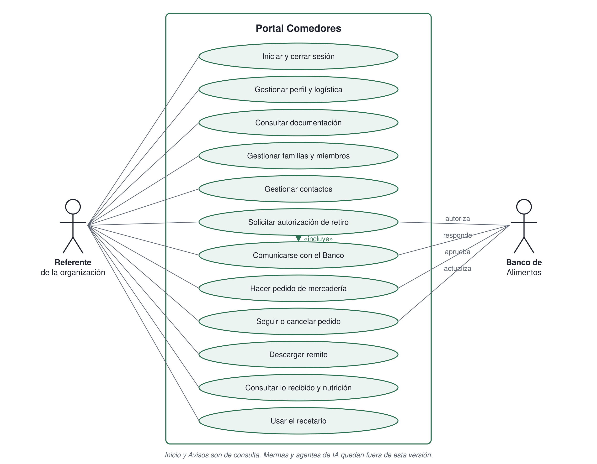

# Capítulo 3. Análisis y requerimientos

## 3.1 Actores

| Actor | Descripción | Relación con el sistema |
|---|---|---|
| Referente de la organización | Coordinador o coordinadora de un comedor o merendero. En la API, rol `organization_coordinator`. | Usuario principal de la aplicación. |
| Banco de Alimentos | Personal del Banco que aprueba pedidos, autoriza contactos, responde interacciones y carga cupos y necesidades nutricionales. | Actor externo: opera desde sus propios sistemas, y la aplicación ve el resultado de sus acciones (estados, avisos, autorizaciones). |
| Plataforma Mermab | Backend del Banco (API REST multiinquilino). | Sistema externo con el que se integra la aplicación. |

La aplicación está destinada **exclusivamente al rol de organización**. Cuando un usuario autenticado
no pertenece a una organización, se lo dirige a una pantalla que informa que la aplicación no es para
su perfil.

## 3.2 Relevamiento

Los requerimientos se obtuvieron de cuatro fuentes, en orden creciente de autoridad:

1. **Propuesta de tesis** acordada con el Banco el 8 de septiembre de 2026: definió las
   funcionalidades esperadas a alto nivel.
2. **Inventario de la especificación OpenAPI** de la plataforma (Fase 0). Permitió conocer el universo
   de servicios, pero reveló brechas importantes. Entre ellas, que las respuestas exitosas no estaban
   documentadas y que había identificadores de operación duplicados y enumeraciones inconsistentes.
3. **Guía de la API para organizaciones** entregada por el Banco el 29 de septiembre de 2026: seis
   documentos con ejemplos reales probados contra el servidor, los defectos conocidos y lo que todavía
   no existía.
4. **Serie "API organizaciones" (1/14 a 14/14)**, publicada por el Banco el 7 de octubre de 2026. Son
   más de 75 servicios con solicitudes y respuestas reales, más un orden de implementación sugerido.
   Desde esa fecha, esta serie es la fuente de verdad del backend. Cada módulo implementado conserva una
   copia de su documento en el repositorio.

Cuando dos fuentes se contradicen, prevalece la más reciente y, por sobre todas, **el comportamiento
verificado del servidor** (sección 3.8).

## 3.3 Requerimientos funcionales

Los requerimientos funcionales se agrupan por módulo. Su código (RF-xx) se usa en la validación del
Capítulo 6.

### Sesión y perfil del usuario

| Código | Requerimiento |
|---|---|
| RF-01 | Iniciar sesión con correo electrónico y contraseña. |
| RF-02 | Mantener la sesión abierta entre usos de la aplicación, renovando el token antes de su vencimiento. |
| RF-03 | Cerrar la sesión y eliminar del dispositivo los datos almacenados. |
| RF-04 | Consultar y modificar los datos personales del usuario y cambiar la contraseña. |

### Inicio

| Código | Requerimiento |
|---|---|
| RF-05 | Mostrar un resumen de la organización: impacto, familias y personas asistidas, cupo del mes, pedidos en curso, cobertura nutricional del mes, mensajes pendientes con el Banco y avisos sin leer. |

### Organización

| Código | Requerimiento |
|---|---|
| RF-06 | Consultar el perfil de la organización y editar los campos que el Banco permite modificar. |
| RF-07 | Actualizar la dirección de la organización, con la opción de tomar la ubicación del dispositivo. |
| RF-08 | Consultar y editar la capacidad logística: días y horarios preferidos de retiro, capacidad de transporte y de almacenamiento. |
| RF-09 | Consultar los requisitos documentales, los documentos presentados y la ficha social, y descargar los documentos. |

### Familias

| Código | Requerimiento |
|---|---|
| RF-10 | Listar las familias asistidas, con búsqueda y filtro por estado. |
| RF-11 | Consultar el detalle de una familia y de sus miembros. |
| RF-12 | Dar de alta, editar, inactivar, reactivar y eliminar familias, con un formulario configurado por el Banco. |
| RF-13 | Agregar, editar y dar de baja miembros de una familia, y designar al referente del hogar. |
| RF-14 | Advertir si un DNI ya está registrado al cargar una persona. |
| RF-15 | Mostrar un resumen demográfico de las personas asistidas por edad y por condición. |

### Contactos

| Código | Requerimiento |
|---|---|
| RF-16 | Listar, dar de alta, editar y dar de baja a las personas de contacto de la organización. |
| RF-17 | Designar al contacto principal. |
| RF-18 | Mostrar si una persona está autorizada por el Banco a retirar alimentos, con el alcance y la vigencia de la autorización. |
| RF-19 | Solicitar al Banco la autorización de una persona para retirar alimentos. |

### Pedidos de mercadería

| Código | Requerimiento |
|---|---|
| RF-20 | Consultar el catálogo de productos disponibles, con búsqueda y filtro por categoría. |
| RF-21 | Consultar el cupo mensual: asignado, recibido, pedido en curso y restante. |
| RF-22 | Armar un pedido indicando productos y cantidades, fecha y franja de retiro, motivo y urgencia. |
| RF-23 | Revisar el pedido antes de enviarlo y ver cómo queda el cupo. |
| RF-24 | Listar los pedidos (en curso, entregados, todos) y consultar el detalle y el estado de cada uno. |
| RF-25 | Cancelar un pedido que el Banco todavía no aprobó, indicando el motivo. |
| RF-26 | Descargar el remito de un pedido listo para retirar. |

### Lo recibido y nutrición

| Código | Requerimiento |
|---|---|
| RF-27 | Consultar lo recibido del Banco en un período, con un resumen por origen y por mes. |
| RF-28 | Consultar la cobertura nutricional de un mes, total y por grupo de alimentos, frente a la necesidad de las familias. |
| RF-29 | Consultar la cuota mensual y las necesidades estimadas de las familias según su composición. |

### Comunicación con el Banco

| Código | Requerimiento |
|---|---|
| RF-30 | Enviar al Banco un suceso, una solicitud, una consulta o un reclamo. |
| RF-31 | Listar los mensajes enviados con filtros por tipo y estado, ver los contadores y el detalle con su seguimiento. |

### Avisos

| Código | Requerimiento |
|---|---|
| RF-32 | Listar los avisos, marcarlos como leídos (de a uno o todos) y eliminarlos. |
| RF-33 | Navegar desde un aviso a la entidad que lo originó (por ejemplo, un pedido). |

### Recetario

| Código | Requerimiento |
|---|---|
| RF-34 | Consultar un recetario con recetas adecuadas a los alimentos que entrega el Banco. |
| RF-35 | Escalar las cantidades de una receta según la cantidad de personas, con unidades prácticas. |
| RF-36 | Seguir una receta paso a paso en un "modo cocina". |

<!-- PENDIENTE: requerimientos del módulo de mermas y de los agentes de IA. -->

## 3.4 Requerimientos no funcionales

| Código | Categoría | Requerimiento |
|---|---|---|
| RNF-01 | Portabilidad | Ejecutarse en Android, iOS y navegadores web desde una única base de código. |
| RNF-02 | Rendimiento | Funcionar con fluidez en dispositivos de gama baja; las listas extensas deben virtualizarse. |
| RNF-03 | Disponibilidad | Mostrar la última información conocida sin conexión, avisar del estado de la red y revalidar al reconectarse. |
| RNF-04 | Usabilidad | Lenguaje llano en español, una acción principal por pantalla y mensajes de error comprensibles para el usuario (sin códigos técnicos). |
| RNF-05 | Accesibilidad | Áreas táctiles de al menos 48 px, texto base de 16 px, contraste suficiente y significado nunca transmitido sólo por el color. |
| RNF-06 | Seguridad | Token almacenado en el almacenamiento seguro del sistema operativo; ninguna credencial en el código ni en el paquete distribuido; uso exclusivo de la credencial del usuario (nunca claves del inquilino). |
| RNF-07 | Robustez | Ninguna acción del usuario debe duplicarse por un reintento (idempotencia de las escrituras). |
| RNF-08 | Respeto del servidor | No superar el límite de 60 solicitudes por minuto del servidor y no reintentar en ráfaga. |
| RNF-09 | Integridad de la integración | No invocar servicios que el Banco no habilitó para el rol de organización. |
| RNF-10 | Mantenibilidad | Código tipado, con verificación de tipos y análisis estático sin errores antes de cada commit, y organizado por módulos independientes. |
| RNF-11 | Verificabilidad | Poder desarrollar y demostrar la aplicación sin afectar los datos de producción. |

## 3.5 Historias de usuario y casos de uso

La Figura 3.1 presenta el diagrama de casos de uso del sistema, con sus dos actores. Las historias
de usuario que siguen resumen las necesidades principales desde la perspectiva del referente.

| Código | Historia |
|---|---|
| HU-01 | Como referente, quiero ver al abrir la aplicación cuánto me queda del cupo del mes y si tengo pedidos en curso, para planificar las comidas. |
| HU-02 | Como referente, quiero pedir mercadería eligiendo del catálogo del Banco, para no tener que hacerlo por mensajes. |
| HU-03 | Como referente, quiero saber en qué estado está mi pedido y descargar el remito cuando esté listo, para ir a retirarlo. |
| HU-04 | Como referente, quiero registrar a una familia nueva y a sus integrantes, para que el Banco conozca a quiénes asistimos. |
| HU-05 | Como referente, quiero ver cuánto de lo que necesitan mis familias cubrió lo que recibí este mes, para saber qué grupos de alimentos faltan. |
| HU-06 | Como referente, quiero avisarle al Banco de un problema o hacerle una consulta y ver si me respondió. |
| HU-07 | Como referente, quiero mantener actualizada la lista de personas de la organización y pedir que autoricen a alguien a retirar alimentos. |
| HU-08 | Como referente, quiero ajustar una receta a la cantidad de personas que comen hoy. |
| HU-09 | Como referente, quiero seguir viendo mis datos aunque me quede sin señal. |

### Caso de uso principal: realizar un pedido de mercadería

- **Actor:** referente de la organización.
- **Precondiciones:** sesión iniciada; módulo de pedidos habilitado; menos de tres pedidos esperando
  respuesta del Banco.
- **Flujo principal:**
  1. El referente abre la sección Mercadería y elige "Hacer un pedido".
  2. El sistema muestra el catálogo con su disponibilidad y el cupo restante.
  3. El referente busca o filtra productos y establece una cantidad para cada uno.
  4. El referente continúa a la revisión.
  5. El sistema muestra el detalle con los kilogramos totales y cómo queda el cupo.
  6. El referente elige el día y la franja de retiro y, opcionalmente, indica el motivo y la urgencia.
  7. El referente confirma.
  8. El sistema envía el pedido con una clave de idempotencia y muestra su detalle en estado
     "Pendiente de revisión".
- **Flujos alternativos:**
  - **8a.** El Banco acepta el pedido con advertencias de stock o de cupo. El sistema las muestra en un
    diálogo antes de abrir el detalle.
  - **8b.** Falla la conexión. El sistema informa el error, y el referente reintenta con la misma clave
    sin que el pedido se duplique.
  - **8c.** El servidor rechaza datos inválidos (422). El sistema muestra cada error junto al campo
    correspondiente.
- **Postcondiciones:** el pedido queda registrado en el Banco, que recibe un aviso; la lista de pedidos
  y el cupo se actualizan.

### Caso de uso: solicitar la autorización de un contacto

1. El referente abre la ficha de un contacto sin autorización vigente y con DNI cargado.
2. Elige "Pedir autorización al Banco".
3. El sistema abre el formulario de comunicación con el Banco, con el tipo "solicitud", el asunto y el
   detalle ya completos.
4. El referente revisa el mensaje y lo envía.
5. Cuando el Banco otorga la autorización, la ficha del contacto la muestra, y el nombre y el DNI de la
   persona quedan bloqueados para edición.

## 3.6 Reglas de negocio del Banco

Las reglas siguientes provienen de la documentación del Banco y del comportamiento verificado del
servidor. La aplicación las aplica también del lado del cliente, para anticipar los errores en lugar
de esperar el rechazo del servidor.

| Módulo | Regla |
|---|---|
| Sesión | El token vence a las 24 horas. Al renovarlo, el anterior deja de ser válido de inmediato. |
| Sesión | Cambiar la contraseña no cierra las sesiones abiertas. |
| Pedidos | La fecha de retiro no puede ser anterior al día actual. |
| Pedidos | Un pedido admite hasta 30 productos distintos, sin repetir, con cantidades mayores que cero. |
| Pedidos | Una organización puede tener hasta 3 pedidos esperando respuesta (`pendiente` o `en_revision`). |
| Pedidos | El pedido se acepta aunque supere el stock o el cupo; en ese caso, el servidor devuelve advertencias. El cupo es informativo. |
| Pedidos | El Banco define las cantidades definitivas al aprobar y fija la fecha de entrega. |
| Pedidos | Sólo se puede cancelar un pedido que el Banco no aprobó, y la cancelación exige un motivo. |
| Pedidos | El remito está disponible desde que el pedido está listo para retirar. |
| Contactos | El DNI no puede repetirse dentro de la organización. |
| Contactos | Si el Banco autorizó a una persona a retirar, su nombre y su DNI no pueden modificarse. |
| Contactos | Autorizar a una persona es una atribución exclusiva del Banco. La organización puede solicitarlo mediante una interacción de tipo solicitud. |
| Contactos | Hay un único contacto principal; al marcar uno nuevo, el anterior se desmarca. |
| Familias | Cada familia tiene un único referente del hogar; al designar uno nuevo, el anterior se desmarca. |
| Familias | Los campos visibles, obligatorios y sus opciones los define el Banco (`form-config`). |
| Familias | Una familia inactiva deja de contar en el resumen demográfico. |
| Interacciones | Los tipos válidos son suceso, solicitud, consulta y reclamo. El asunto admite hasta 255 caracteres y el detalle, hasta 5000. |
| Interacciones | Sólo se pueden crear y consultar; no se editan ni se eliminan. Su estado es `pendiente` o `atendida`. |
| Organización | Los días preferidos de retiro se expresan en minúscula y sin tilde. Los horarios usan el formato `HH:MM`, y el fin debe ser posterior al inicio. |
| Organización | Algunos campos del perfil son exclusivos del Banco (`FIELD_NOT_EDITABLE`). |
| Lo recibido | El período consultado no puede superar un año, y la fecha final no puede ser anterior a la inicial. |
| General | No superar 60 solicitudes por minuto por usuario (10 por minuto para el inicio de sesión). |
| General | Toda escritura debe llevar el encabezado `Idempotency-Key`. |

## 3.7 Trazabilidad entre la propuesta y lo implementado

| Funcionalidad de la propuesta | Estado en este trabajo | Requerimientos |
|---|---|---|
| Gestión de pedidos (solicitar alimentos con cantidades y motivo, consultar el estado) | Implementada | RF-20 a RF-26 |
| Registro de familias (composición, edades, necesidades) | Implementada | RF-10 a RF-15 |
| Panel nutricional (cobertura del aporte del Banco frente a las necesidades) | Implementada | RF-27 a RF-29 |
| Cursos y capacitación | No implementada: el Banco no ofrece contenidos para el rol de organización | — |
| Stock interno del comedor (trazabilidad de la organización a la familia) | No implementada: no existe en el backend | — |
| Muro de necesidades | Cubierta parcialmente por la comunicación con el Banco (solicitudes y sucesos) | RF-30, RF-31 |
| Funcionalidades agregadas durante el análisis | Contactos y autorizaciones, perfil y logística, documentación, avisos, recetario | RF-06 a RF-09, RF-16 a RF-19, RF-32 a RF-36 |

<!-- PENDIENTE: fila del chatbot de WhatsApp con agentes de IA y del módulo de mermas. -->

## 3.8 Brechas con el backend y su gestión

La aplicación depende de un backend que el equipo no controla, de modo que una parte relevante del
análisis consistió en identificar y gestionar sus brechas. Cada una se registró con un código (G-xx) en
un documento dirigido al Banco. Las brechas se agrupan en cuatro categorías:

- **Contrato incompleto.** La especificación OpenAPI no documenta las respuestas exitosas (G-01) ni los
  permisos de cada servicio por rol (G-02). Contiene identificadores de operación duplicados y
  enumeraciones que no coinciden con las que usa el servidor (G-07). Varios servicios, como las
  interacciones, no figuran en ella.
- **Defectos conocidos del servidor** (G-12). Algunos errores responden 500 cuando corresponde otro
  código: un identificador que no es UUID (debería ser 404), una dirección inválida (debería ser 422) o
  el exceso del límite de solicitudes (debería ser 429). El intercambio de recursos entre orígenes
  (CORS) admite sólo los puertos 3000 y 3001 en la web (G-03). Las notificaciones *push* funcionan sólo
  en la web (G-06).
- **Diferencias entre la documentación y el servidor.** Por ejemplo, la documentación afirmaba que
  enviar `null` en un campo no lo modificaba, pero el servidor lo borraba (G-15). El servidor envía
  además campos no documentados, como `summary.reconciliation_pending` en lo recibido (G-19), y algunos
  números como texto (`"300.00"`).
- **Servicios inexistentes.** En el momento del relevamiento no existían, entre otros, el alta de
  familias, los pedidos, los contactos y la documentación para el rol de organización. Se solicitaron
  formalmente al Banco y se habilitaron progresivamente entre el 7 y el 20 de octubre de 2026. La
  recuperación de contraseña y las notificaciones *push* nativas siguen pendientes.

Para gestionar estas brechas se adoptaron tres criterios, que condicionaron el diseño (Capítulo 4):

1. **Verificar antes de mostrar.** Ninguna regla del backend se presenta al usuario sin comprobarla
   antes contra el servidor con el usuario de prueba.
2. **Activar por módulo.** Un módulo sólo se activa con la API real cuando el Banco lo habilitó y su
   funcionamiento fue verificado.
3. **Ser defensivo en el cliente.** Se validan los identificadores antes de enviarlos, se aceptan
   números en forma de texto y se traducen los errores 500 conocidos a mensajes adecuados.
