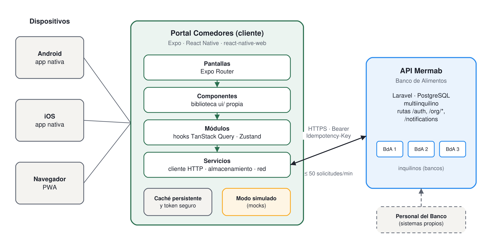
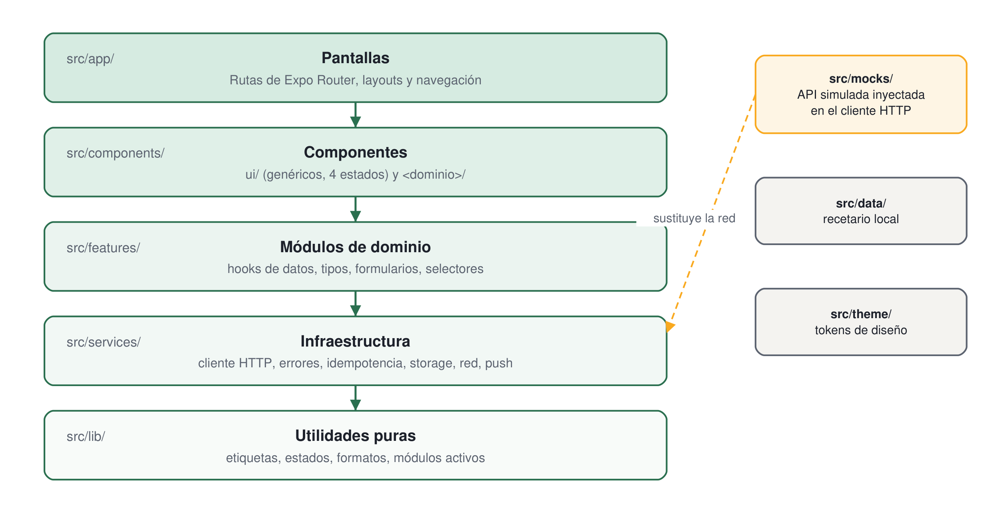
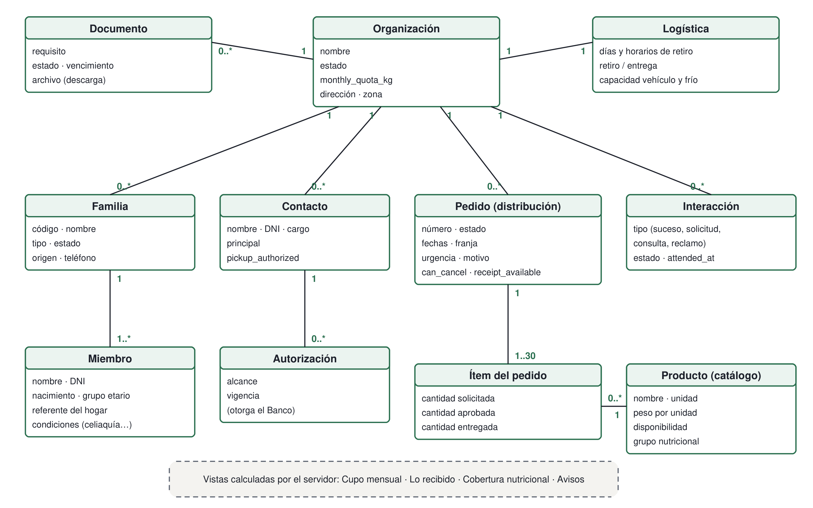
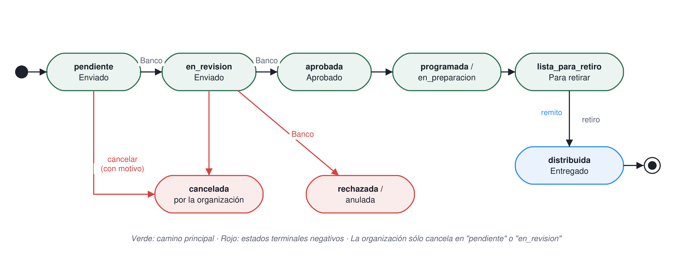
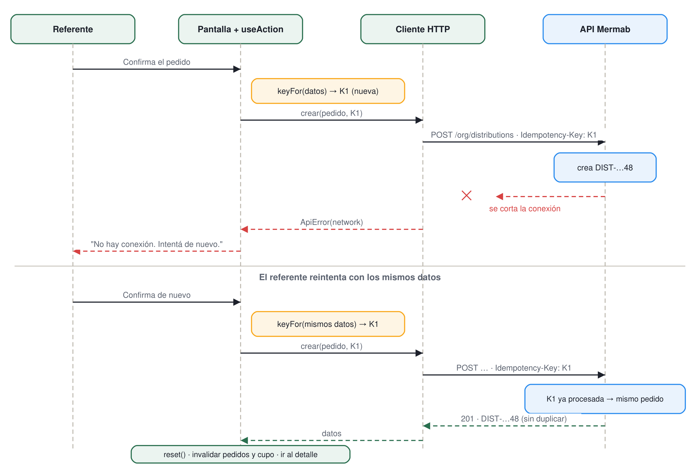
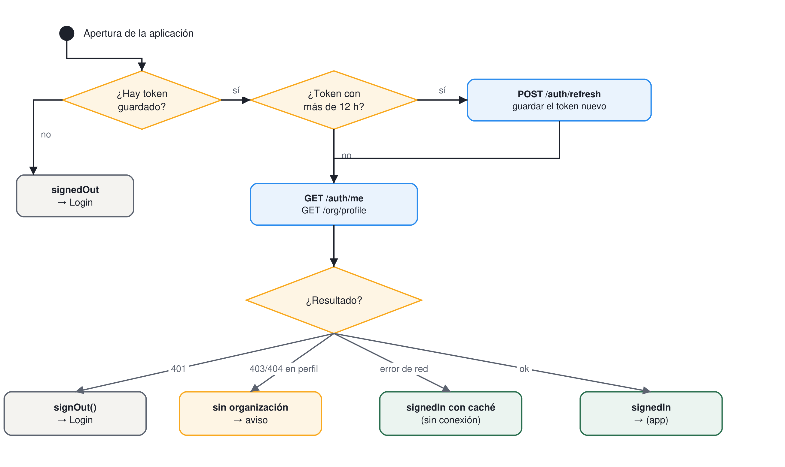
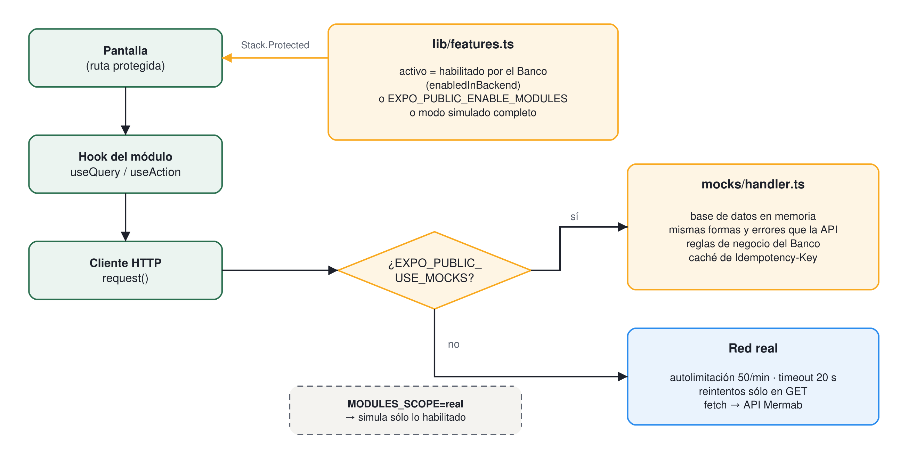
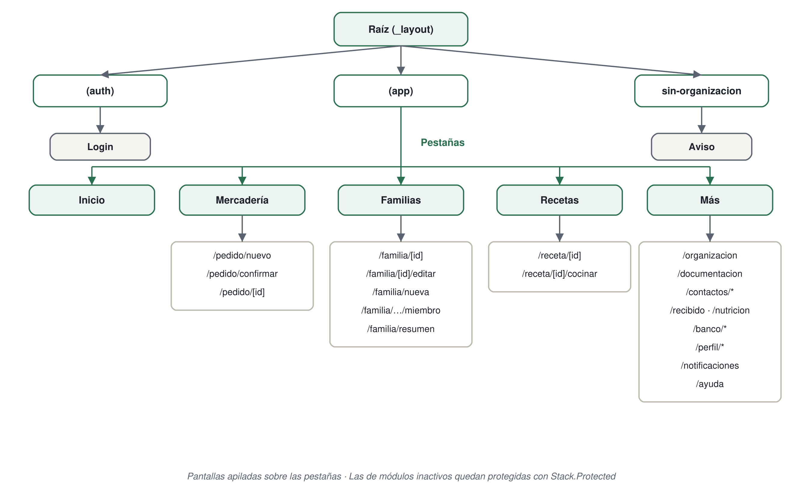

# Capítulo 4. Diseño y arquitectura del sistema

## 4.1 Arquitectura general

El sistema sigue una arquitectura **cliente-servidor**. La aplicación desarrollada en este trabajo es
el cliente; el servidor es la plataforma Mermab del Banco, que el equipo no modifica.

El cliente no guarda una copia autoritativa de los datos: la fuente de verdad es siempre el servidor.
La caché local cumple dos funciones: mejorar la respuesta percibida y permitir el uso sin conexión. La
organización a la que pertenece el usuario la resuelve el servidor a partir del token, y por eso los
servicios del rol de organización (`/org/*`) no reciben el identificador de la organización.

<!-- PENDIENTE: agregar a la figura el servicio de agentes de IA y el canal de WhatsApp. -->

### El servidor: la plataforma Mermab

El backend del sistema es **Mermab Cloud**, la plataforma de gestión que usa el Banco de Alimentos para
toda su operación. La desarrolla y mantiene el área técnica del Banco; el equipo la utilizó con la
autorización de la gerencia, participó en la definición de la parte destinada a las organizaciones y
la validó contra el servidor real, pero no modificó su código.

**Alcance.** La plataforma es mucho más amplia que lo que usa la aplicación: su especificación OpenAPI
describe 388 rutas que cubren donantes y donaciones, inventario, compras y facturas, sucursales,
mermas y sus retiros, distribuciones, programas y jornadas, reportes y notificaciones. Para los
comedores y merenderos expone un subconjunto propio, la **API de organizaciones** (`/api/org/*`), que es
la que consume Portal Comedores (Anexo A).

**Tecnología.** Es una API REST sobre HTTPS, en `https://cloud.mermab.com/api`, con respuestas JSON. La
especificación provista por el Banco está generada con Scribe, la herramienta de documentación de
Laravel (PHP), lo que indica que el backend está construido sobre ese *framework*.
<!-- PENDIENTE: confirmar con el Banco la tecnología (Laravel, base de datos, hosting) antes de la versión final. -->

**Multiinquilino.** Una sola instalación atiende a varios bancos de alimentos (*tenants*). Cada usuario
pertenece a un tenant y, si es referente de un comedor, a una organización; el servidor deduce ambos a
partir del token, por eso los servicios `/org/*` no reciben identificadores de organización y una
organización nunca ve datos de otra. Las pruebas del proyecto se hicieron en el tenant *Banco de
Alimentos Patagonia (TEST)*, dentro de la misma base que los bancos reales.

**Seguridad y sesión.**

- Autenticación por *token* Bearer que se obtiene con `POST /auth/login`, dura 24 horas y se renueva con
  `POST /auth/refresh` (el token anterior deja de servir en el acto).
- Control de acceso por **roles y permisos**: el referente de un comedor tiene el rol
  `organization_coordinator`, y cualquier servicio de otro rol responde 403 `INSUFFICIENT_PERMISSION`.
- **Límite de tasa**: 60 pedidos por minuto por usuario y 10 por minuto para el inicio de sesión.
- **Idempotencia**: las escrituras aceptan la cabecera `Idempotency-Key`, de modo que un reintento con
  la misma clave no duplica la operación.
- CORS restringido a los orígenes autorizados.

**Contrato.** Las respuestas siguen un formato uniforme: `{ success, data }` cuando la operación sale
bien y `{ success, message, errors }` cuando falla, con un código de error (`error_code`) en los casos
de negocio. Los errores de validación devuelven 422 con un mensaje por campo, que la aplicación muestra
junto al campo correspondiente.

**Reglas de negocio en el servidor.** El backend es la fuente de verdad de las reglas del Banco: cupo
mensual por organización, hasta 30 productos por pedido y hasta 3 pedidos esperando respuesta, campos
del perfil que sólo puede editar el Banco, contactos autorizados a retirar, estados del pedido y
avisos a la organización cuando el Banco aprueba, rechaza o deja listo un pedido. La aplicación repite
esas reglas en el cliente para avisar antes de enviar, pero la decisión final es siempre del servidor.

**Trabajo del equipo sobre el backend.** Aunque no lo programó, el equipo tuvo un rol activo en su
evolución para el uso de las organizaciones:

1. **Relevamiento y pedido de servicios.** El equipo relevó qué necesitaban los comedores y se lo
   planteó al Banco (1/10 y 5/10). En respuesta, el Banco publicó la serie "API organizaciones" (14
   documentos, 7/10) y habilitó permisos y servicios nuevos, como el alta y la edición de familias.
2. **Validación del contrato.** Cada servicio se verificó contra el servidor real: una prueba de humo
   automatizada (25/25 en su última corrida) y verificaciones puntuales de supuestos (capítulo 6).
3. **Registro de brechas.** Se documentaron 22 faltantes y comportamientos inesperados (G-01 a G-22,
   sección 3.8), por ejemplo: errores 500 en lugar de 422 o 429, un documento listado sin archivo y la
   falta de un servicio para que la organización suba documentos. Varios fueron corregidos por el
   Banco durante el proyecto.
4. **Diseño defensivo del cliente.** Como el backend evolucionó en paralelo a la aplicación, el cliente
   se diseñó para tolerarlo: interruptores por módulo (sección 4.6), un simulador fiel a las respuestas
   reales y reintentos seguros con idempotencia (sección 4.4).

Además, el equipo escribió un componente de servidor propio, acotado: el **proxy del asistente**
(`scripts/assistant-proxy.js`), que reenvía las llamadas del chat a la plataforma de agentes, porque
ésta no admite CORS desde el navegador (D-26).

## 4.2 Arquitectura por capas del cliente

El código fuente se organiza en capas con responsabilidades separadas y dependencias en un único
sentido: las pantallas dependen de los módulos, y los módulos dependen de los servicios.

| Capa | Responsabilidad | Ejemplos |
|---|---|---|
| Pantallas | Componer la interfaz de cada ruta y orquestar la navegación. No acceden a la red directamente. | `src/app/(app)/pedido/nuevo.tsx` |
| Componentes | Presentación reutilizable. La biblioteca `ui/` resuelve los cuatro estados de toda vista de datos: carga, vacío, error y datos. | `Button`, `Card`, `QueryView`, `InfiniteList`, `DistributionCard` |
| Módulos (*features*) | Lógica de cada dominio: consultas y mutaciones, tipos de respuesta, conversión entre formulario y cuerpo de la API. | `features/pedidos/hooks.ts`, `features/pedidos/cart.ts` |
| Servicios | Comunicación con el exterior y políticas transversales (reintentos, límites, errores). | `services/api/client.ts`, `services/storage.ts` |
| Utilidades | Funciones puras sin dependencias de React. | `lib/labels.ts`, `lib/recipe-scale.ts` |

Cada módulo de dominio tiene su propio archivo de servicios (por ejemplo,
`services/api/endpoints/familias.ts`) y sus propias claves de consulta. Esta separación permitió que
varios integrantes trabajaran en paralelo sobre módulos distintos con pocos conflictos de integración
(D-12).

## 4.3 Modelo de dominio consumido

Como el backend pertenece al Banco, el trabajo no incluyó el diseño de una base de datos. Sí incluyó el
**modelo de dominio que el cliente consume**, expresado en tipos de TypeScript a partir de las
respuestas reales del servidor. La Figura 4.3 resume las entidades y sus relaciones.

| Entidad | Atributos principales | Observaciones |
|---|---|---|
| Organización | nombre, estado (`pendiente`, `verificada`, `aprobada`, `suspendida`, `inactiva`), cupo mensual (kg), dirección, zona | Una por usuario de organización. |
| Logística | días y horarios preferidos de retiro, preferencia de retiro o entrega, capacidad del vehículo y de frío | Editable dentro de los límites del Banco. |
| Familia | código, nombre, tipo de familia, estado (`activa`, `inactiva`, `suspendida`), origen, teléfono, situación habitacional | El origen distingue las cargas manuales de las inscripciones por programa. |
| Miembro | nombre, documento, fecha de nacimiento, grupo etario, parentesco, referente del hogar, condiciones (embarazo, lactancia, celiaquía, diabetes, discapacidad, entre otras) | Las condiciones alimentan la estimación de necesidades nutricionales. |
| Contacto | nombre, DNI, cargo, teléfono, correo, principal, autorizado a retirar, autorizaciones (alcance y vigencia) | La autorización la otorga sólo el Banco. |
| Producto del catálogo | nombre, unidad, peso por unidad, disponibilidad (`disponible`, `poco_stock`), categoría, grupo nutricional | No expone cantidades de stock. |
| Pedido (distribución) | número, estado, fechas solicitada, programada y efectiva, franja, urgencia, motivo, total de kg, `can_cancel`, `receipt_available`, ítems | Su ciclo de vida se muestra en la Figura 4.4. |
| Ítem del pedido | producto, unidad, cantidad solicitada, aprobada y entregada | El Banco fija la cantidad aprobada. |
| Cupo | mes, cupo, entregado, pedido en curso, restante, `enforced` | Hoy es informativo (`enforced: false`). |
| Lo recibido | entregas por período con origen (pedido o merma), kg, productos y remito; resumen por origen y por mes | — |
| Cobertura nutricional | por mes y por grupo de alimentos: kg recibidos, necesidad (kg) y porcentaje de cobertura | Puede no estar disponible si el Banco no cargó las necesidades. |
| Interacción | tipo (suceso, solicitud, consulta, reclamo), asunto, detalle, estado (`pendiente`, `atendida`), fecha de atención | Sólo alta y lectura. |
| Aviso | título, mensaje, fecha, leído, datos de navegación | Lo genera el servidor ante eventos (por ejemplo, la aprobación de un pedido). |

### Ciclo de vida del pedido de mercadería

La organización sólo puede cancelar en los estados `pendiente` y `en_revision`; el resto de las
transiciones las ejecuta el Banco.

En la interfaz, este ciclo se simplifica en un indicador de pasos (*stepper*) con cinco etapas:
Enviado, Aprobado, Armando, Para retirar y Entregado. Los estados terminales negativos (rechazado, cancelado,
anulado) se muestran con su motivo. Los botones de cancelar y descargar el remito no se deducen del
estado: dependen de los indicadores `can_cancel` y `receipt_available` que envía el servidor, para no
duplicar en el cliente reglas que pertenecen al backend.

## 4.4 Diseño del cliente HTTP

Toda comunicación con la API pasa por un único cliente (`src/services/api/client.ts`), que concentra
las políticas transversales. Así, ninguna pantalla debe ocuparse de ellas.

1. **Encabezados.** `Accept: application/json`, `Content-Type` cuando hay cuerpo, y
   `Authorization: Bearer <token>`. Nunca se usa la clave `X-API-Key` del inquilino, reservada para la
   comunicación entre sistemas.
2. **Desenvoltura de respuestas.** La API responde con el envoltorio
   `{ success, data, meta?, message?, errors? }`, que el cliente desenvuelve. También normaliza las dos
   formas de paginación que usa el servidor: `{ data: [...], meta }` y `{ data: { data: [...], meta } }`.
3. **Autolimitación.** El cliente lleva una ventana deslizante de 60 segundos y no emite más de 50
   solicitudes por minuto. Deja así un margen respecto del límite de 60 del servidor, que, al
   excederse, responde 500 en lugar de 429.
4. **Política de reintentos.** Sólo las lecturas (GET) se reintentan automáticamente, hasta dos veces,
   ante errores de red, 429 o 500, con una espera creciente o la indicada por `Retry-After`. Las
   escrituras nunca se reintentan solas: el reintento es una decisión del usuario.
5. **Idempotencia.** Todo POST lleva un encabezado `Idempotency-Key`. Si el llamador no provee una, el
   cliente la genera.
6. **Tiempo de espera.** Cada solicitud se cancela a los 20 segundos.
7. **Errores tipados.** Toda falla se convierte en un `ApiError` con una categoría (red, tiempo de
   espera, no autorizado, prohibido, no encontrado, validación, conflicto, límite, servidor), el código
   HTTP, el mensaje del servidor, los errores por campo y el código de negocio (`error_code`). Una
   función traduce cada categoría a un mensaje en español comprensible para el usuario; para los
   errores de negocio (422, 409), prioriza el mensaje que envía el Banco.
8. **Sesión vencida.** Ante un 401, el cliente notifica al almacén de sesión, que borra el token y
   vuelve a la pantalla de ingreso.
9. **Punto de sustitución.** El cliente admite un manejador alternativo que reemplaza a la red. Es el
   mecanismo que habilita el modo simulado (sección 4.6).

### Idempotencia por intención del usuario

Generar una clave nueva en cada envío no alcanza: si el usuario reintenta después de un error de red,
la segunda solicitud llevaría otra clave y el servidor la trataría como una operación distinta. Por
eso se diseñó la clave **por intención**: el *hook* `useIdempotencyKey` calcula una huella de los datos
de la acción.

- Si el usuario reintenta con los mismos datos, se reutiliza la misma clave, y el servidor devuelve el
  resultado original sin duplicar la operación.
- Si los datos cambian, se trata de una intención distinta y se genera otra clave.
- Cuando la acción termina bien, la clave se descarta.

La Figura 4.5 muestra el escenario que motiva el diseño: el pedido se crea en el servidor, pero la
respuesta se pierde por un corte de conexión. Al reintentar con los mismos datos, la aplicación envía la
misma clave, y el servidor devuelve el pedido ya creado en lugar de crear otro.

Todas las mutaciones de la aplicación usan este mecanismo a través de `useAction`. Ese *hook* también
invalida las consultas afectadas y muestra el resultado al usuario.

## 4.5 Sesión y protección de rutas

La sesión se modela como un almacén de Zustand con tres estados: `loading`, `signedOut` y `signedIn`.

- **Almacenamiento seguro.** En Android e iOS, el token se guarda en el almacenamiento cifrado del
  sistema operativo (`expo-secure-store`); en la web, en `localStorage`. También se guarda la hora de
  emisión, para decidir cuándo rotarlo.
- **Rotación.** Como el token dura 24 horas y el anterior se invalida al renovarlo, se renueva al abrir
  la aplicación si tiene más de 12 horas, y se guarda el nuevo antes de continuar.
- **Protección declarativa de rutas.** El navegador raíz usa `Stack.Protected` con guardas derivadas
  del estado de la sesión. Cada grupo de rutas (`(auth)`, `(app)`, `sin-organizacion`) sólo existe
  cuando su guarda es verdadera, de modo que no se puede acceder a él ni siquiera escribiendo la URL en
  la web.
- **Cierre de sesión.** Al cerrar la sesión se invalida el token en el servidor, si hay conexión, y se
  borran el token, la caché en memoria y la caché persistida.

## 4.6 Módulos condicionados al backend y modo simulado

### Interruptores por módulo

El backend habilitó sus servicios para el rol de organización de forma progresiva, y la documentación
del Banco establece que invocar un servicio no habilitado (respuesta 403) "es un error de la
aplicación". Por eso se diseñó un mecanismo de **interruptores por módulo** (`src/lib/features.ts`).

- Cada módulo funcional tiene un identificador: `familiasAlta`, `pedidos`, `contactos`, `recibido`,
  `documentacion`, entre otros.
- Un módulo está activo si figura en la lista de módulos habilitados por el Banco y verificados
  (`enabledInBackend`), si se fuerza por una variable de entorno (`EXPO_PUBLIC_ENABLE_MODULES`) o si la
  aplicación corre en modo simulado completo.
- Las pantallas de un módulo inactivo quedan protegidas con `Stack.Protected`, y sus accesos
  desaparecen de los menús, de modo que no se realiza ninguna solicitud a servicios no habilitados.
- Activar un módulo que el Banco acaba de habilitar no requiere modificar las pantallas: basta con
  agregarlo a la lista o a la variable de entorno.

### Modo simulado

Con la variable `EXPO_PUBLIC_USE_MOCKS=true`, el cliente HTTP delega cada solicitud en un enrutador
de simulación (`src/mocks/handler.ts`) que reproduce la API con **la misma forma que la real**:

- el envoltorio y la paginación;
- los errores 401, 404, 409 y 422 con sus códigos de negocio;
- las reglas de negocio (límite de tres pedidos abiertos, advertencias de stock y cupo, DNI repetido,
  identidad bloqueada de un contacto autorizado);
- la exigencia de `Idempotency-Key`, con una caché que devuelve el mismo resultado ante la misma
  clave;
- los defectos conocidos del servidor (por ejemplo, el 500 ante un identificador que no es UUID).

La variable `EXPO_PUBLIC_MODULES_SCOPE=real` limita el modo simulado a los módulos habilitados en
producción, para ensayar la aplicación tal como la vería un usuario real. Este diseño resuelve una
restricción central del proyecto: la API sólo existe en producción. Gracias a él, se pueden probar los
flujos de escritura sin crear datos en el inquilino del Banco y hacer demostraciones sin depender de la
conectividad.

## 4.7 Navegación y mapa de pantallas

La navegación combina una barra de pestañas inferior con pilas de pantallas superpuestas. Con la API
real, las pestañas son **Inicio**, **Mercadería**, **Familias**, **Recetas** y **Más**.

| Sección | Rutas | Contenido |
|---|---|---|
| Ingreso | `/login` | Credenciales y ayuda. |
| Inicio | `/` (pestaña) | Resumen de la organización, cupo, pedidos, alimentación del mes, mensajes y avisos. |
| Mercadería | `/mercaderia` (pestaña), `/pedido/nuevo`, `/pedido/confirmar`, `/pedido/[id]` | Pedidos en curso y entregados; armado en dos pasos; detalle. |
| Familias | `/familias` (pestaña), `/familia/[id]`, `/familia/[id]/editar`, `/familia/nueva`, `/familia/[id]/miembro/*`, `/familia/resumen` | Padrón, fichas, formularios y resumen demográfico. |
| Recetas | `/recetas` (pestaña), `/receta/[id]`, `/receta/[id]/cocinar` | Recetario, escalado y modo cocina. |
| Más | `/mas` (pestaña) | Accesos agrupados: Mi organización, Alimentación, Cuenta y Ayuda. |
| Organización | `/organizacion`, `/documentacion`, `/contactos`, `/contactos/nuevo`, `/contactos/[id]` | Perfil, dirección, logística, documentos y contactos. |
| Alimentación | `/recibido`, `/nutricion` | Lo recibido y cobertura nutricional. |
| Comunicación | `/banco`, `/banco/nueva`, `/banco/[id]` | Mensajes al Banco. |
| Cuenta | `/perfil`, `/perfil/contrasena`, `/notificaciones`, `/ayuda` | Datos del usuario, contraseña, avisos y preguntas frecuentes. |

Las rutas de detalle de familia usan el singular (`/familia/...`) para no colisionar con la pestaña
`/familias` (P-10). El formulario de comunicación con el Banco acepta parámetros (`tipo`, `titulo`,
`notas`) para que otras pantallas lo abran precompletado, como en la solicitud de autorización de un
contacto (D-17).

## 4.8 Sistema de diseño y accesibilidad

- **Paleta.** El color primario es un verde salvia (`#3B9B6E`), sobre un fondo blanco cálido
  (`#FDFDFC`). Los colores de estado son éxito, advertencia, información y error. Los valores se
  definen como *tokens* HSL en `src/global.css`, para las clases de NativeWind, y en hexadecimal en
  `src/theme/tokens.ts`, para íconos y navegación.
- **Forma.** Radios de 6, 8, 10 y 14 px, y forma de píldora; nunca esquinas rectas.
- **Accesibilidad.** Áreas táctiles de 48 px, texto base de 16 px y margen lateral de 16 px. Cada
  estado se comunica con color, ícono y texto, nunca sólo con color.
- **Lenguaje.** Toda enumeración de la API se presenta con una etiqueta en español
  (`src/lib/labels.ts`), y cada estado tiene asociados un color y un ícono (`src/lib/status.ts`). Los
  nombres internos se adaptaron al vocabulario del usuario: por ejemplo, "Mercadería" y "pedido de
  mercadería", para distinguirlos de otros usos de "pedido".
- **Estados de datos.** Toda vista que depende del servidor contempla cuatro estados: carga (esqueleto
  animado), error (mensaje y botón de reintento), vacío (mensaje y acción sugerida) y datos.
- **Biblioteca de componentes propia.** Botón, tarjeta, chip, insignia, diálogo, hoja inferior,
  formulario, selector, lista, avatar, esqueleto y notificación emergente (*toast*), entre otros.

## 4.9 Síntesis de decisiones de diseño

| Código | Decisión | Motivo |
|---|---|---|
| D-01 | Código fuente bajo `src/`, con alias `@/` | Convención de Expo Router y separación entre rutas y resto del código. |
| D-03 | Tipos generados para las solicitudes y escritos a mano para las respuestas, con cliente propio | La especificación no documenta las respuestas. |
| D-04 | Servidor web de desarrollo en el puerto 3000 | Restricción de CORS del backend. |
| D-05 | Salida web como aplicación de página única (SPA) | La aplicación está completamente autenticada y no se beneficia de la generación estática. |
| D-06 | Clave de idempotencia en todo método de escritura | Seguridad ante reintentos. |
| D-08 | Acoplarse al backend real, con interruptores por módulo y simulación con las formas reales | La guía del Banco pasa a ser la fuente de verdad. |
| D-12 | Familias sobre `/org/families*`, con un archivo de servicios por módulo | Organización resuelta por el servidor; trabajo en paralelo. |
| D-13 | Comunicación con el Banco sólo de alta y lectura, con seguimiento en tres pasos | Limitaciones de la API. |
| D-15 | Pedido de mercadería en dos pasos, con el borrador en memoria | Revisión antes de enviar; un borrador no es un dato del servidor. |
| D-16 | Contactos con pantallas propias e identidad bloqueada si están autorizados | Reglas del Banco. |
| D-17 | La solicitud de autorización reutiliza el formulario de comunicación | Indicación del Banco y reutilización de código. |
| D-19 | Panel nutricional sobre `/org/nutrition`, con niveles de cobertura | Servicio indicado por el Banco para el rol de organización. |
| D-20 | Lo recibido con períodos predefinidos | Evita períodos inválidos. |
| D-21 | Perfil, logística y documentación sobre `/org/*`, con edición parcial | Servicios del rol de organización; sólo se envía lo modificado. |

El registro completo se presenta en el Anexo B.
