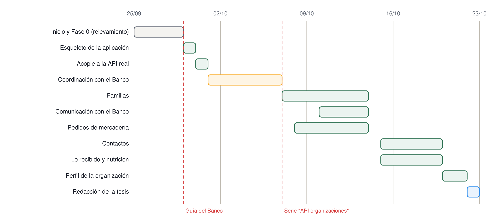
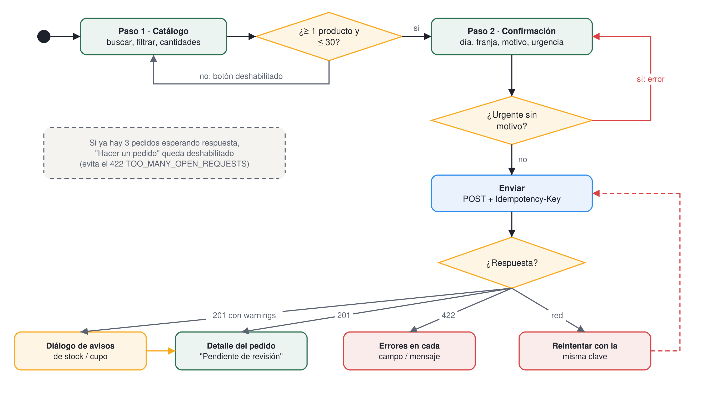

# Capítulo 5. Implementación y desarrollo

## 5.1 Entorno, herramientas y flujo de trabajo

| Aspecto | Herramienta o práctica |
|---|---|
| Control de versiones | Git, con repositorio compartido. Una rama por módulo e integrante (`feature-tomas-familias`, `InteraccionBanco`, `mercaderias`, `Contacto`, `recibido-nutricion`, `perfil-organizacion`), integradas a `main` mediante *merge*. |
| Convención de commits | Conventional Commits (`feat:`, `fix:`, `docs:`, `chore:`, `test:`, `refactor:`). |
| Calidad estática | `tsc --noEmit` (verificación de tipos) y `expo lint` (ESLint con la configuración de Expo y las reglas del React Compiler) antes de cada commit. Formato con Prettier. |
| Ejecución | `expo start` para Android, iOS y web. En la web, el puerto 3000 es el único admitido por el CORS del backend (D-04). |
| Configuración | Variables `EXPO_PUBLIC_*` en un archivo `.env`, excluido del control de versiones. Las credenciales de prueba sólo se leen en scripts locales y nunca entran al paquete de la aplicación. |
| Documentación | Bitácora por commit, registro de decisiones (D-xx), de problemas (P-xx) y de brechas del backend (G-xx). |
| Asistencia | Herramientas de IA para generar y revisar código y documentación, bajo la supervisión del equipo. |

El desarrollo se extendió entre el 25 de septiembre y el 22 de octubre de 2026. A esa fecha, el
repositorio tiene alrededor de 17.500 líneas de TypeScript (sin contar los tipos generados), 51
archivos de pantallas y *layouts* y 42 componentes.

## 5.2 Etapas del desarrollo

| Etapa | Fecha | Hitos |
|---|---|---|
| Inicio | 25/09 | Proyecto creado con `create-expo` (SDK 57) y limpieza de la plantilla. |
| Fase 0: relevamiento | 25/09 a 29/09 | Inventario de la especificación OpenAPI, brechas iniciales, decisiones D-01 a D-07 y mapa de pantallas. |
| Esqueleto de la aplicación | 30/09 | Estructura en capas, sistema de diseño y biblioteca de componentes, cliente HTTP, sesión, caché persistente, modo simulado, PWA y recetario. |
| Acople a la API real | 30/09 | Adaptación a la guía del Banco (D-08): interruptores por módulo, reglas del cliente, simulaciones con las formas reales y prueba de humo. |
| Coordinación con el Banco | 01/10 a 07/10 | Solicitud integral de servicios faltantes con propuestas de contrato. El 7/10, el Banco publica la serie "API organizaciones" y habilita la escritura de familias. |
| Familias | 14/10 | Migración a `/org/families*`, alta, edición, baja y miembros; verificación contra el servidor (P-14). |
| Comunicación con el Banco | 14/10 | Módulo de interacciones (D-13). |
| Pedidos de mercadería | 14/10 | Catálogo, cupo, pedido en dos pasos, seguimiento, cancelación y remito (D-14, D-15). |
| Contactos | 20/10 | Padrón, autorizaciones y solicitud de autorización (D-16, D-17). |
| Lo recibido y nutrición | 20/10 | Lo recibido por período y cobertura nutricional por grupo (D-18 a D-20). |
| Perfil de la organización | 22/10 | Perfil editable, logística, documentación y ficha social (D-21). |



## 5.3 Infraestructura transversal

### 5.3.1 Cliente HTTP y políticas de comunicación

El cliente (`src/services/api/client.ts`) implementa las políticas descritas en la sección 4.4. Su
núcleo es la función `request`, que aplica la autolimitación, construye los encabezados, ejecuta la
solicitud con un tiempo de espera, decide si reintentar y convierte toda falla en un `ApiError`. La
autolimitación se implementa con una ventana deslizante de marcas de tiempo:

```ts
const MAX_PER_MINUTE = 50;

async function throttle(): Promise<void> {
  const now = Date.now();
  state.sent = state.sent.filter((t) => now - t < 60_000);
  if (state.sent.length >= MAX_PER_MINUTE) {
    await sleep(60_000 - (now - state.sent[0]) + 50);
    return throttle();
  }
  state.sent.push(Date.now());
}
```

Los reintentos se coordinaron entre dos niveles para que no se multiplicaran (P-12). El cliente
reintenta las lecturas ante 500, 429 o falla de red. TanStack Query, en cambio, sólo agrega un
reintento adicional ante falla de red, con espera exponencial y una componente aleatoria. Las
mutaciones no se reintentan automáticamente.

### 5.3.2 Acciones idempotentes

Todas las escrituras de la aplicación se implementan con el *hook* `useAction`, que combina una
mutación de TanStack Query con la clave de idempotencia por intención:

```ts
export function useIdempotencyKey() {
  const ref = useRef<{ key: string; fingerprint: string } | null>(null);
  return {
    keyFor(variables: unknown): string {
      const fingerprint = safeStringify(variables);
      if (!ref.current || ref.current.fingerprint !== fingerprint) {
        ref.current = { key: newIdempotencyKey(), fingerprint };
      }
      return ref.current.key;
    },
    reset() { ref.current = null; },
  };
}
```

Cuando una acción termina bien, `useAction` descarta la clave, invalida las claves de consulta
declaradas (por ejemplo, la lista de pedidos y el cupo) y muestra un mensaje de confirmación. Si falla,
muestra el mensaje traducido del error. La función `applyFieldErrors` vuelca los errores 422 del
servidor en los campos del formulario de react-hook-form, de modo que cada error aparezca junto al
campo correspondiente.

### 5.3.3 Caché, persistencia y conectividad

- **Configuración de la caché.** Las consultas se consideran frescas durante 60 segundos y se
  conservan 24 horas. Se revalidan al reconectarse y al volver el foco a la aplicación.
- **Persistencia selectiva.** Sólo se guardan en el dispositivo las consultas marcadas con
  `meta: { persist: true }` (perfil de la organización, familias, demografía, recetas), mediante un
  persistidor sobre AsyncStorage (nativo) o `localStorage` (web), con vigencia de 24 horas.
- **Detección de red.** `wireNetworkAndFocus` conecta NetInfo con el `onlineManager` de TanStack Query
  y, en las plataformas nativas, el ciclo de vida de la aplicación (`AppState`) con el
  `focusManager`. Una franja visible informa al usuario cuando no hay conexión.
- **Detalles con máquina de estados.** Para las entidades cuyo estado cambia del lado del servidor, el
  tiempo de frescura es cero. Así se muestra de inmediato lo que está en caché y se revalida en
  segundo plano (P-06).

### 5.3.4 Almacenamiento por plataforma

El almacenamiento se abstrae en un servicio con dos implementaciones, que se resuelven por la extensión
del archivo (`storage.ts` para nativo y `storage.web.ts` para web). El mismo patrón se aplicó a las
descargas (`download.ts` y `download.web.ts`) y a las notificaciones (`push.ts` y `push.web.ts`):

- **Nativo:** el token va a `expo-secure-store` y el resto de los datos, a AsyncStorage. Las descargas
  se guardan en el sistema de archivos y se abren con el visor del sistema.
- **Web:** se usa `localStorage`. Las descargas se resuelven con una URL de objeto (*blob*), y las
  notificaciones, con Web Push a través del *service worker*.

### 5.3.5 Aplicación web progresiva

La versión web se exporta como aplicación de página única (D-05) e incluye un manifiesto, íconos y un
*service worker* propio (`public/sw.js`):

- las navegaciones se resuelven primero por red y, sin conexión, con el esqueleto guardado;
- los recursos estáticos se sirven primero desde la caché;
- la API no se guarda en el *service worker*, porque de eso se encarga la caché persistente de TanStack
  Query.

### 5.3.6 Biblioteca de componentes

Se construyó una biblioteca propia en `src/components/ui/` sobre NativeWind. Sus piezas principales
son:

- `QueryView` e `InfiniteList`: resuelven los cuatro estados de toda vista de datos. `InfiniteList`
  combina FlashList con la paginación de la API.
- `Form`, `Input`, `Select` y `Chip`: formularios accesibles integrados con react-hook-form.
- `Dialog`, `BottomSheet` y `Toast`: diálogos, hojas inferiores y mensajes emergentes.
- `Skeleton`, `Badge`, `Avatar`, `Card`, `ListItem` y `Layout`.

En el modo de desarrollo, una pantalla de catálogo (`/dev/ui`) muestra todos los componentes, y otra
(`/dev/diagnostico`) verifica la conexión con la API.

## 5.4 Implementación por módulo

### 5.4.1 Sesión y perfil del usuario

El almacén `useSession` (Zustand) implementa el flujo de la Figura 4.6:

- `hydrate` restaura la sesión y rota el token si corresponde;
- `signIn` autentica, guarda el token y carga el perfil;
- `signOut` invalida el token en el servidor y borra toda la información local.

La respuesta de `/auth/me` se valida con un esquema de zod, y en desarrollo se emite una advertencia si
no coincide con lo esperado. La pertenencia a una organización se confirma consultando
`/org/profile`: una respuesta 403 o 404 indica que el usuario no pertenece a una organización. El
perfil del usuario permite editar sus datos y cambiar la contraseña.

### 5.4.2 Inicio

La pantalla de inicio reúne en tarjetas los indicadores de la organización: el impacto (de
`/org/stats`), las familias y personas asistidas (`/org/families/demographics`), el cupo del mes y los
pedidos en curso, la cobertura nutricional del mes con los dos grupos menos cubiertos, los mensajes
pendientes con el Banco y los avisos sin leer. Cada tarjeta resuelve sus estados de forma
independiente, de modo que la falla de un servicio no impide ver el resto.

### 5.4.3 Organización: perfil, dirección, logística y documentación

- **Perfil y logística.** Se editan en hojas inferiores dentro de "Mi organización" (`ProfileSheet` y
  `LogisticsSheet`). La conversión entre los valores del formulario y el cuerpo de la API se aisló en
  `src/features/org/form.ts`, que también calcula qué campos cambiaron: sólo esos se envían, y nunca
  los que administra el Banco.
- **Reglas del Banco en el cliente.** Días de retiro con chips (lunes a sábado), normalizados a
  minúscula y sin tilde; horas con máscara `HH:MM` y validación de que el fin sea posterior al inicio;
  correo electrónico válido; capacidades no negativas. Los errores 422 que el servidor devuelve por
  posición (`preferred_pickup_days.0`) se asignan al campo correspondiente.
- **Dirección.** Se valida antes de enviarla (calle, ciudad, provincia y coordenadas dentro de rango),
  porque el servidor responde 500 ante una dirección inválida. Admite tomar la ubicación del
  dispositivo con `expo-location`.
- **Documentación.** Lista los requisitos, los documentos presentados y la ficha social, y permite
  descargar los documentos. Para distinguir un documento inexistente (`DOCUMENT_NOT_FOUND`) de un corte
  de conexión, se amplió la descarga autenticada para que lea el código de error del cuerpo de la
  respuesta.

### 5.4.4 Familias y miembros

- **Lista.** Paginación infinita, búsqueda y filtro por estado.
- **Ficha.** Datos de la familia, miembros y acciones disponibles.
- **Formulario configurable.** Se arma a partir de `GET /org/families/form-config`, que define qué
  campos se muestran, cuáles son obligatorios y las opciones de cada lista. Las etiquetas en español
  provienen de `labels.ts`.
- **Miembros.** Formulario con datos personales y condiciones relevantes para la alimentación
  (embarazo, lactancia, celiaquía, diabetes, intolerancia a la lactosa, discapacidad). Al designar un
  nuevo referente del hogar, el anterior se desmarca.
- **Aviso de DNI existente** (`DniHint`). Mientras se escribe un DNI, se busca si ya está registrado en
  otra familia y se informa en cuál. La búsqueda espera 600 ms sin cambios antes de consultar
  (*debounce*), para no generar una solicitud por cada tecla y no consumir el límite del servidor.
- **Edición parcial.** Mediante `changedFields`, sólo se envían los campos modificados. Esto fue
  necesario después de verificar que enviar `null` o una cadena vacía borra el dato en el servidor
  (P-14).
- **Resumen demográfico** por grupo etario y por condición.

### 5.4.5 Contactos

Se implementaron pantallas propias de lista, alta y ficha (D-16).

- **Autorizaciones.** La ficha muestra si la persona está autorizada a retirar alimentos, con su
  alcance y vigencia. Si lo está, el nombre y el DNI aparecen bloqueados (con un candado). Aun así,
  la aplicación maneja el conflicto 409 `CONTACT_IDENTITY_LOCKED`, por si el Banco otorgó la
  autorización mientras se editaba: en ese caso, restaura los valores guardados y recarga.
- **Contacto principal.** Se marca con un interruptor; el backend desmarca al anterior y la aplicación
  recarga la lista.
- **Solicitud de autorización.** El botón "Pedir autorización al Banco" abre el formulario de
  comunicación precompletado (D-17). El mensaje no se envía solo: la persona lo revisa y confirma.
- **Errores de negocio.** Se ramifica por `error_code`: `CONTACT_NOT_FOUND` vuelve a la lista
  actualizada, y `CONTACT_DECLARED_FOR_PICKUP` se informa en la ficha.

### 5.4.6 Pedidos de mercadería

Es el módulo con más reglas de negocio. El flujo de alta se implementó en dos pasos (D-15):

1. **Catálogo** (`/pedido/nuevo`). Búsqueda y filtro por categoría (las categorías se derivan del
   propio catálogo), disponibilidad ("Quedan pocas") y selector de cantidad por producto. Un resumen
   fijo muestra la cantidad de productos y los kilogramos.
2. **Confirmación** (`/pedido/confirmar`). Revisión y edición de cantidades, cupo resultante, día de
   retiro (chips de hoy a 13 días después, sin agregar dependencias nativas), franja (sin preferencia,
   mañana o tarde), motivo y urgencia. Si se marca la urgencia, el motivo es obligatorio.



El borrador vive en un almacén de Zustand en memoria (`cart.ts`), indexado por producto, lo que impide
repetir productos y limita el pedido a 30. El botón "Hacer un pedido" se deshabilita cuando hay tres
pedidos esperando respuesta. Así se evita llegar al error `TOO_MANY_OPEN_REQUESTS`, aunque si el
servidor igual lo devuelve, se muestra su mensaje. Las advertencias de stock y de cupo que acompañan a
un pedido aceptado se presentan en un diálogo antes de abrir el detalle.

El detalle muestra el indicador de pasos, los productos con las cantidades solicitadas y aprobadas (y
resalta las diferencias), y las acciones disponibles según `can_cancel` y `receipt_available`.
La cancelación exige un motivo. El remito PDF se descarga con la misma autorización del usuario.

### 5.4.7 Lo recibido y cobertura nutricional

- **Lo recibido** (`/recibido`). Chips de período (último mes, 3 meses, 6 meses, último año), que
  terminan siempre en el día actual y, por construcción, nunca generan un período inválido. Incluye un
  resumen del período completo, un filtro por origen (sólo si hay entregas de más de un origen) y una
  lista paginada en la que cada entrega abre el detalle del pedido. Como `/org/received` no sigue la
  forma de paginación de las demás listas, el servicio usa `request` directamente y devuelve
  `{ summary, items, meta }` (P-20).
- **Cobertura nutricional** (`/nutricion`). Selector de mes (del actual hasta 11 meses atrás),
  cobertura total y por grupo de alimentos, en kg recibidos frente a la necesidad y en porcentaje. Cada
  grupo tiene un nivel con ícono y texto: "Cubierto" (100 % o más), "En camino" (50 % a 99 %) y "Falta"
  (menos de 50 %). Este criterio es propio del equipo y está pendiente de validación con el área social
  del Banco. Si el Banco no cargó las necesidades por grupo, sólo se muestran los kilogramos, con un
  aviso. Debajo se presentan la cuota mensual y las necesidades estimadas de las familias.

### 5.4.8 Comunicación con el Banco

Lista con contadores por estado y filtros por tipo y estado, resueltos en el servidor; formulario de
alta y detalle (D-13).

- **Formulario.** Aplica los límites del backend (asunto de hasta 255 caracteres y detalle de hasta
  5000), muestra los errores 422 en cada campo y usa una clave de idempotencia por intención. Acepta
  parámetros para abrirse precompletado.
- **Seguimiento.** Se muestra en tres pasos: Enviado, Esperando al Banco y Atendido. Al crear un
  mensaje se invalidan todas las consultas `['interactions', …]`: lista, resumen y detalle.
- **Sin edición ni borrado.** Como la API no permite editar ni eliminar interacciones, la aplicación
  tampoco lo ofrece.

### 5.4.9 Avisos

Lista paginada de avisos, contador de no leídos en el encabezado (`NotificationBell`), marcado
individual y masivo, eliminación y navegación a la entidad de origen. Para evitar botones anidados en la
web, cada fila se compone de dos zonas presionables hermanas (P-04).

### 5.4.10 Recetario

El recetario es local (`src/data/recetas/`) porque el backend no tiene un módulo de recetas (G-10).
Cada receta se valida con un esquema de zod, y el acceso se abstrae en un repositorio
(`features/recetas/repository.ts`). El escalado (`lib/recipe-scale.ts`) ajusta las cantidades a la
cantidad de personas con redondeos prácticos por unidad:

- los gramos se redondean a múltiplos de 5, 10 o 50 y pasan a kilogramos desde 1000 g;
- las unidades se redondean a medias hasta 3 y a enteros desde ahí;
- las cucharadas y las tazas se expresan en fracciones (¼, ½, ¾) y, desde unos 120 ml, pasan a
  mililitros o litros, para evitar resultados como "25 ½ cucharadas" de aceite (P-09).

El "modo cocina" presenta los pasos de a uno ("Paso N de M"), para seguir la preparación sin perder el lugar.

<!-- PENDIENTE: implementación del módulo de mermas (disponibles, postulaciones, retiros y quién
retira) y de la integración con los agentes de IA y WhatsApp. -->

## 5.5 Patrones aplicados

| Patrón | Dónde | Propósito |
|---|---|---|
| Arquitectura en capas | `app`, `components`, `features`, `services`, `lib` | Separar presentación, dominio e infraestructura. |
| *Facade* (fachada) | `services/api/client.ts` y el objeto `api` | Un punto único con las políticas de comunicación. |
| *Repository* | `features/recetas/repository.ts`, servicios por módulo (`orgApi`, `familiasApi`…) | Aislar la fuente de los datos del resto de la aplicación. |
| *Adapter* | `toPage` (paginación), `form.ts` (formulario ⇄ API), `labels.ts` | Normalizar formas heterogéneas de la API. |
| Implementaciones por plataforma | `storage(.web).ts`, `download(.web).ts`, `push(.web).ts` | Una interfaz común con resolución por extensión de archivo. |
| *Feature toggles* | `lib/features.ts` y `Stack.Protected` | Activar módulos según la disponibilidad del backend. |
| *Service virtualization* | `mocks/handler.ts` inyectado en el cliente | Simular la API con su forma real. |
| *Hooks* por dominio | `features/*/hooks.ts` | Encapsular consultas, mutaciones e invalidaciones. |
| Fábrica de claves de consulta | `features/query-keys.ts` (`qk`) | Claves jerárquicas que permiten invalidar por prefijo. |
| Clave de idempotencia | `useIdempotencyKey`, `useAction` | Escrituras seguras ante reintentos. |
| Componente con cuatro estados | `QueryView`, `InfiniteList` | Tratamiento uniforme de carga, vacío, error y datos. |

## 5.6 Herramientas propias

| Comando | Herramienta | Función |
|---|---|---|
| `npm run gen:api` | `scripts/gen-api.mjs` | Genera los tipos desde OpenAPI, después de renombrar los identificadores de operación duplicados (P-01). |
| `npm run smoke` | `scripts/smoke-test.ts` | Prueba de humo contra la API real. Es un equivalente en TypeScript del script del Banco, que no requiere `jq` ni `uuidgen` (D-09). La opción `--familias` agrega pruebas de escritura con limpieza posterior, y `--samples` guarda muestras enmascaradas de las respuestas. |
| `npm run recetas:convertir` | `scripts/convertir-recetas.ts` | Convierte recetarios en JSON o CSV al formato validado de la aplicación. |
| `npm run bitacora` | `scripts/bitacora.mjs` | Lista los commits sin entrada en la bitácora y, opcionalmente, genera su esqueleto. |
| `npm run build:web` | `expo export -p web` | Exporta la versión web. |

## 5.7 Problemas técnicos y soluciones

Durante el desarrollo se registraron 21 problemas técnicos (Anexo C). La tabla siguiente sintetiza
los más relevantes por su impacto en el diseño.

| Código | Problema | Solución | Lección |
|---|---|---|---|
| P-01 | Los tipos generados fusionaban operaciones distintas por identificadores duplicados en OpenAPI. | Normalizar la especificación antes de generar. | Una especificación externa debe tratarse como entrada no confiable. |
| P-06 | Al reabrir un detalle se mostraba un estado anterior desde la caché persistida. | Tiempo de frescura cero en las entidades con máquina de estados. | La persistencia exige definir la frescura por tipo de dato. |
| P-11 | Las pestañas ocultas seguían accesibles por URL en la web. | Proteger las rutas con `Stack.Protected` o redirección. | Ocultar no equivale a proteger. |
| P-12 | Los reintentos del cliente y de la caché se multiplicaban. | Reintentos coordinados en dos niveles y autolimitación. | Las políticas de reintento deben diseñarse en conjunto. |
| P-14 | La documentación decía que `null` no borra un dato, pero el servidor sí lo borraba. | Edición parcial con campos modificados; simulación ajustada. | Verificar contra el servidor antes de mostrar una regla. |
| P-15 | Los servicios de interacciones no figuraban en OpenAPI. | Tipos escritos a partir de las respuestas reales documentadas. | La documentación vigente puede adelantarse a la especificación. |
| P-18 | El error 422 del servidor no se mostraba en el formulario de contactos. | Leer el error desde `fieldState` de cada campo. | El memoizado automático del React Compiler exige suscribirse al estado correcto. |
| P-19 | "Mi organización" fallaba con la API real porque un número llegaba como texto. | Formateadores que aceptan número o texto. | Las simulaciones deben reproducir también los tipos reales. |
| P-20 | `/org/received` usa una forma de paginación distinta. | Servicio específico que devuelve resumen, ítems y metadatos. | No generalizar sin verificar cada servicio. |
