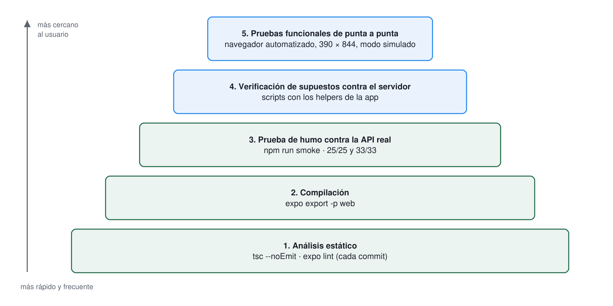

# Capítulo 6. Pruebas y validación

## 6.1 Estrategia de verificación

Las condiciones del proyecto determinaron la estrategia de verificación. La API sólo existe en
producción y es compartida con bancos reales. El usuario de prueba pertenece a una organización
ficticia y tiene permisos de escritura limitados. Además, los servicios se habilitaron de forma
progresiva durante el desarrollo. En ese contexto, se combinaron cinco niveles:

| Nivel | Técnica | Qué detecta | Cuándo se aplica |
|---|---|---|---|
| 1. Análisis estático | `tsc --noEmit` (TypeScript estricto) y `expo lint` (ESLint y reglas del React Compiler) | Errores de tipos, de contrato con la API y de uso de *hooks* | Antes de cada commit y después de cada integración a `main` |
| 2. Compilación | `expo export -p web` | Rutas inválidas, importaciones rotas | Al agregar rutas o módulos |
| 3. Prueba de humo contra la API real | `npm run smoke` | Cambios en la forma de las respuestas, servicios no habilitados, errores del servidor | Al acoplar o habilitar un módulo |
| 4. Verificación de supuestos contra el servidor | Scripts descartables con los mismos *helpers* de la aplicación | Diferencias entre la documentación y el comportamiento real | Antes de mostrar una regla del backend al usuario |
| 5. Pruebas funcionales de punta a punta | Navegador automatizado (Playwright o Chrome sin interfaz por CDP) sobre la versión web en modo simulado, con pantalla de celular (390 × 844) | Fallas de flujo, de interfaz y errores de consola | Al terminar cada módulo |

Las pruebas de punta a punta se ejecutaron en la configuración "como en producción" del modo simulado
(`EXPO_PUBLIC_USE_MOCKS=true` y `EXPO_PUBLIC_MODULES_SCOPE=real`). Esa configuración presenta sólo los
módulos habilitados por el Banco, con respuestas de la misma forma que las reales. Así se pudieron
ejercitar los flujos de escritura completos (crear, cancelar, eliminar) sin generar datos ni avisos en
el inquilino del Banco.

## 6.2 Prueba de humo contra la API real

La prueba de humo (`scripts/smoke-test.ts`) inicia sesión con el usuario de prueba y recorre los
servicios principales. Para cada uno verifica el código HTTP y la forma de la respuesta. Las
credenciales se leen del archivo `.env` local y nunca se imprimen.

| Grupo | Verificaciones |
|---|---|
| Sesión | Capacidades sin token; inicio de sesión; `/auth/me`; cierre de sesión y rechazo posterior del token |
| Organización | Perfil, estadísticas |
| Familias | Lista paginada, detalle, demografía, filtro inválido (422), identificador inexistente (404) |
| Lo recibido y nutrición | Lista con resumen, período invertido (422), cobertura del mes |
| Avisos | Contador, lista, aviso de prueba, marcar como leído, eliminar |
| Perfil | Validación de teléfono inválido (422) |
| Permisos | Servicio del rol del Banco rechazado para la organización |
| Escritura de familias (`--familias`) | Alta, edición, borrado con `null`, referente único, miembros, búsqueda por DNI, baja y limpieza |

**Resultados registrados:**

| Fecha | Ejecución | Resultado |
|---|---|---|
| 14/10/2026 | `npm run smoke -- --familias` | 33 verificaciones exitosas, 0 fallidas (12 de escritura de familias). La familia de prueba se eliminó. |
| 20/10/2026 | `npm run smoke:samples` | 25 verificaciones exitosas, 0 fallidas. Las muestras enmascaradas confirmaron que las formas de respuesta coinciden con los tipos de la aplicación. |

## 6.3 Verificaciones de supuestos contra el servidor

Antes de habilitar cada módulo con la API real, se contrastaron sus supuestos con el servidor:

- **Familias (14/10).** Se confirmó que el alta acepta todos los campos que envía la aplicación; que la
  edición acepta el cambio de tipo de familia; que `null` y la cadena vacía borran un dato
  (contradiciendo la documentación, P-14); que designar un nuevo referente del hogar desmarca al
  anterior; que un miembro inactivo sigue apareciendo en la búsqueda por DNI; que una familia inactiva
  deja de contar en la demografía; y que eliminar una familia elimina también a sus miembros.
- **Pedidos de mercadería (14/10).** Catálogo (7 productos), cupo, listado, filtro de pedidos abiertos,
  detalle con ítems y remito PDF (200, `application/pdf`). El alta y la cancelación no se ejecutaron
  contra el servidor real, porque generan pedidos y avisos en el inquilino del Banco; se verificaron
  sobre la simulación.
- **Contactos (20/10).** Lista; alta de un contacto de prueba (201); DNI repetido (422 en `dni`);
  edición (200); 409 `CONTACT_IDENTITY_LOCKED` sobre un contacto autorizado, sin modificarlo; 404
  `CONTACT_NOT_FOUND`; baja (200) y segunda baja (404). El padrón quedó en su estado original.
- **Lo recibido y nutrición (20/10).** Tres entregas y 50,1 kg en los últimos 90 días. La cobertura de
  octubre fue de 21,4 % (50,1 de 234 kg), con 10 kg sin grupo asignado. Se detectó un campo no
  documentado (G-19).
- **Perfil de la organización (22/10).** Los seis servicios de lectura respondieron con la forma
  documentada. Las ediciones de perfil y logística se probaron reenviando los mismos valores, para no
  alterar datos, y con los errores documentados: `FIELD_NOT_EDITABLE`, días con mayúscula, horario
  invertido y correo inválido.

## 6.4 Pruebas funcionales de punta a punta

| Módulo | Fecha | Pasos | Resultado | Escenarios cubiertos |
|---|---|---|---|---|
| Pedidos de mercadería | 14/10 | 37 | 37/37 sin errores de consola | Inicio y cupo; filtros; catálogo, búsqueda y categoría; agregar, modificar y quitar productos; edición en la revisión con recálculo del cupo; urgencia sin motivo (error); envío; advertencias de stock y cupo; límite de tres pedidos; cancelación con motivo obligatorio; pedido listo con cantidad aprobada distinta y descarga del remito; pedido rechazado con motivo; aviso que abre el pedido; identificador inválido; confirmación sin productos |
| Comunicación con el Banco | 14/10 | — | Sin errores de consola | Lista y contadores, filtro de pendientes, detalle pendiente y atendido, validación del formulario vacío, alta de una solicitud y paso al detalle |
| Contactos | 20/10 | 11 | 11/11 sin errores de consola | Acceso desde Mi organización; lista; validación de correo; DNI repetido mostrado en el campo; alta; contacto autorizado con identidad bloqueada; carga de DNI y solicitud de autorización enviada; cambio de contacto principal; baja; URL inexistente |
| Lo recibido y nutrición | 20/10 | 22 | 22/22 sin errores de consola | Inicio; períodos y filtro de origen; apertura de un pedido; cambio de mes en Nutrición; accesos desde Mercadería, Más y Nutrición |
| Integración de ramas | 20/10 | 24 | 24/24 sin errores de consola | Las 22 anteriores, más Mi organización y Contactos sobre el código integrado |

Las pruebas funcionales detectaron defectos que se corrigieron antes de integrar los módulos:

- Detrás del diálogo de advertencias se veía el carrito vacío ("0 productos · 0 kg"). Ahora se vacía
  recién al salir de la pantalla.
- El motivo de cancelación repetía la palabra "Cancelado".
- En la pantalla de celular, dos etiquetas del indicador de pasos se superponían; una se renombró a
  "Armando".
- El error 422 del servidor no aparecía en el campo DNI de los contactos (P-18).

## 6.5 Validación de requerimientos

### Requerimientos funcionales

| Requerimientos | Módulo | Evidencia | Estado |
|---|---|---|---|
| RF-01 a RF-03 | Sesión | Prueba de humo (inicio de sesión, `/auth/me`, cierre de sesión e invalidación del token); flujo de la sesión en las pruebas de punta a punta | Verificado |
| RF-04 | Perfil del usuario | Prueba de humo (validación 422 de `PUT /auth/profile`) | Verificado a nivel API |
| RF-05 | Inicio | Pruebas de punta a punta de pedidos y de lo recibido; prueba de humo de estadísticas y demografía | Verificado |
| RF-06 a RF-09 | Organización | Verificación contra el servidor del 22/10; pruebas de punta a punta de Mi organización | Verificado |
| RF-10 a RF-15 | Familias | Prueba de humo con escritura (33/33) y verificación de supuestos | Verificado a nivel API; recorrido de interfaz pendiente en dispositivo |
| RF-16 a RF-19 | Contactos | Verificación contra el servidor y prueba de punta a punta (11/11) | Verificado |
| RF-20 a RF-26 | Pedidos | Lecturas contra el servidor; prueba de punta a punta (37/37) | Verificado; alta y cancelación reales pendientes |
| RF-27 a RF-29 | Lo recibido y nutrición | Prueba de humo (25/25) y prueba de punta a punta (22/22) | Verificado |
| RF-30, RF-31 | Comunicación con el Banco | Prueba de punta a punta en modo simulado | Verificado en simulación; pendiente contra el servidor (P-17) |
| RF-32, RF-33 | Avisos | Prueba de humo (lista, lectura, eliminación); prueba de punta a punta (aviso → pedido) | Verificado |
| RF-34 a RF-36 | Recetario | Revisión manual; corrección del escalado (P-09) | Verificado manualmente |

### Requerimientos no funcionales

| Código | Evidencia | Estado |
|---|---|---|
| RNF-01 Portabilidad | Base de código única; versión web exportada; ejecución en Expo para Android e iOS | Cumplido en la web; pendiente la prueba en dispositivo físico y el APK |
| RNF-02 Rendimiento | Listas con FlashList y paginación infinita | Cumplido por diseño; sin medición en dispositivo de gama baja |
| RNF-03 Disponibilidad | Caché persistente de 24 h, franja "Sin conexión", revalidación al reconectarse | Cumplido |
| RNF-04 Usabilidad | Traducción de errores a español, etiquetas para toda enumeración | Cumplido; falta la validación con usuarios |
| RNF-05 Accesibilidad | Tokens de 48 px y 16 px; estados con ícono y texto | Cumplido por diseño |
| RNF-06 Seguridad | Token en almacenamiento seguro; credenciales sólo en `.env` local; sin `X-API-Key` | Cumplido |
| RNF-07 Robustez | Clave de idempotencia por intención; prueba "misma clave → mismo pedido" en la simulación | Cumplido |
| RNF-08 Respeto del servidor | Autolimitación a 50/min, reintentos coordinados, espera antes de buscar por DNI | Cumplido |
| RNF-09 Integridad de la integración | Interruptores por módulo y rutas protegidas | Cumplido |
| RNF-10 Mantenibilidad | Tipos y análisis estático sin errores en cada commit e integración | Cumplido |
| RNF-11 Verificabilidad | Modo simulado con formas reales y configuración "como en producción" | Cumplido |

## 6.6 Métricas

| Métrica | Valor |
|---|---|
| Requerimientos funcionales verificados (total o a nivel API) | 36 de 36; 2 sólo en simulación (RF-30 y RF-31) |
| Pasos de las pruebas de punta a punta | 70 pasos en tres corridas de módulo con conteo registrado (37, 11 y 22), más 24 en la corrida de integración, todos exitosos |
| Verificaciones de la prueba de humo | 33/33 (con escritura) y 25/25 (lecturas actualizadas) |
| Errores de tipos y de análisis estático en `main` | 0 |
| Decisiones de diseño registradas | 21 |
| Problemas técnicos registrados y resueltos | 21 (uno resuelto parcialmente: P-17) |
| Brechas del backend documentadas para el Banco | 20 |
| Tamaño de la versión web exportada | 4,6 MB |

## 6.7 Limitaciones de la validación

- **No hay pruebas unitarias ni de componentes automatizadas en el repositorio.** La lógica más
  sensible (conversión de formularios, normalización de días, máscara de horas, cálculo de campos
  modificados) se verificó con scripts ejecutados con `tsx`, pero no se incorporó a una suite
  permanente.
- **Las pruebas de punta a punta se hicieron en la web**, con tamaño de celular, y sus scripts no se
  versionaron. Falta recorrer la aplicación en dispositivos Android e iOS reales.
- **Algunas escrituras no se ejecutaron contra el servidor real** (alta y cancelación de pedidos,
  alta de interacciones), para no generar datos en el inquilino del Banco.
- **No se realizó todavía una validación con usuarios** (referentes de comedores) que mida la
  usabilidad.

<!-- PENDIENTE: pruebas del módulo de mermas, casos de prueba de los agentes de IA (calidad de
respuesta, costo por interacción, latencia) y validación con usuarios. -->
